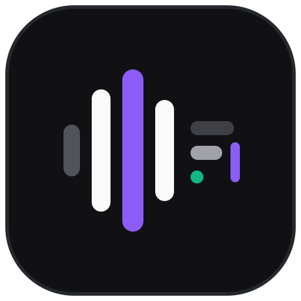
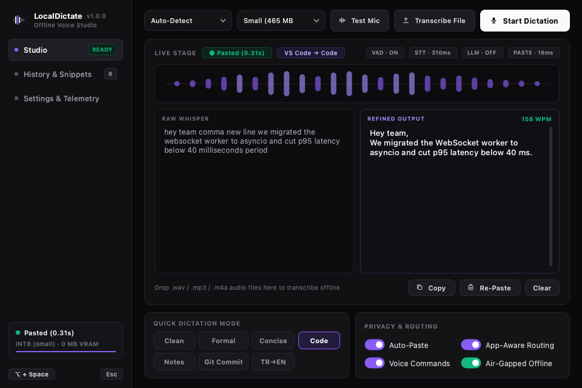
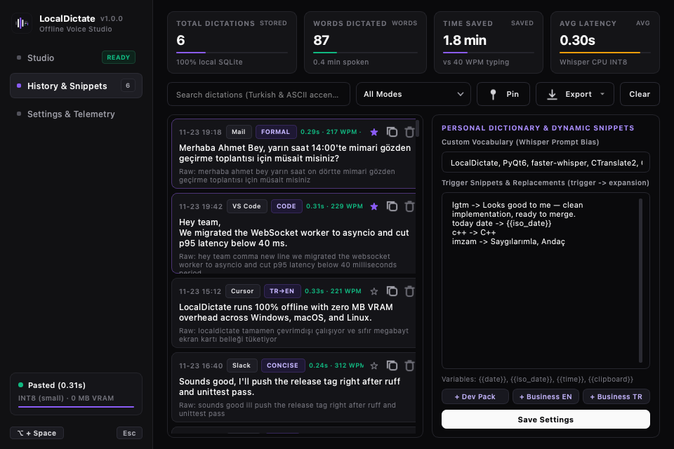
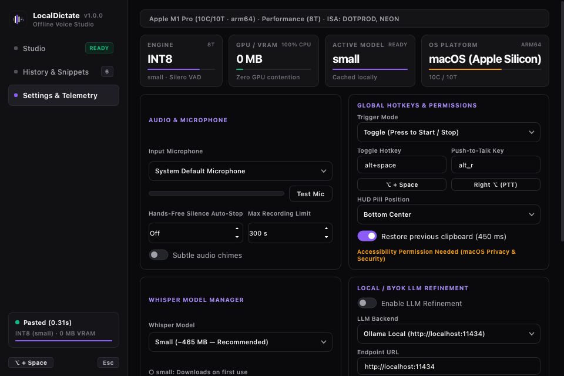
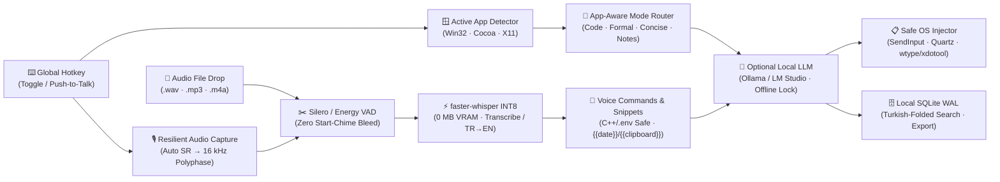
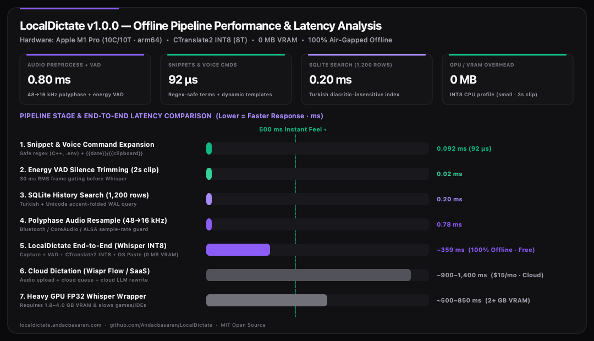

<div align="center">



# 🎙️ LocalDictate — 100% Offline, 0 MB VRAM Desktop AI Voice Studio

**🇬🇧 English (Active)** · **🇹🇷 [Türkçe README](README.tr.md)** · **[💻 Compatibility Matrix](COMPATIBILITY.md)** · **[🤝 Contributing](CONTRIBUTING.md)** · **[🛡️ Security](SECURITY.md)** · **[📜 Changelog](CHANGELOG.md)**

**Ultra-low-latency, 100% air-gapped offline desktop speech-to-text dictation studio powered by `faster-whisper` INT8, Silero VAD, App-Aware Mode Routing, Dynamic Snippets, Voice-to-Translate (`TR→EN`), and optional local Ollama / LM Studio refinement — native on Windows x64, macOS Apple Silicon, and Linux.**

[](https://localdictate.andacbasaran.com)
[-2563EB?style=for-the-badge&logo=windows&logoColor=white)](https://localdictate.andacbasaran.com/downloads/LocalDictate.exe)
[-18181B?style=for-the-badge&logo=apple&logoColor=white)](https://localdictate.andacbasaran.com/downloads/LocalDictate-macOS.dmg)
[-E95420?style=for-the-badge&logo=linux&logoColor=white)](https://localdictate.andacbasaran.com/downloads/LocalDictate-Linux.tar.gz)
[](https://github.com/Andacbasaran/LocalDictate/releases/latest)

[](https://github.com/Andacbasaran/LocalDictate/actions/workflows/ci.yml)
[](https://github.com/Andacbasaran/LocalDictate/releases/latest)
[](https://www.python.org/)
[-41CD52?style=flat-square&logo=qt&logoColor=white)](https://pypi.org/project/PyQt6/)
[](https://github.com/SYSTRAN/faster-whisper)
[-10B981?style=flat-square)](#)
[](LICENSE)

<br/>

[**✨ Why LocalDictate?**](#-why-localdictate-whats-new-in-v100) · [**🖥️ Interface**](#️-studio-20-interface) · [**🏗️ Architecture**](#️-offline-pipeline-architecture) · [**⚖️ Comparison**](#️-how-it-compares) · [**🚀 Download & Install**](#-download--installation) · [**⌨️ Hotkeys & Modes**](#️-global-hotkeys--app-aware-modes) · [**📊 Benchmarks**](#-performance-benchmarks) · [**🗺️ Roadmap**](#️-roadmap)

</div>

---

## ✨ Why LocalDictate? (What's New in v1.0.0)

**LocalDictate** lets you speak naturally in **VS Code, Cursor, Slack, Notion, Apple Mail, Outlook, Terminals, or any desktop app** and pastes clean, punctuated, mode-formatted text directly at your cursor — **100% offline, 0 MB VRAM, zero subscriptions, and zero cloud audio uploads**.

<table>
  <tr>
    <td width="50%">
      <b>🔒 100% Air-Gapped Offline &amp; 0 MB VRAM</b><br/>
      Runs quantized <code>faster-whisper</code> (CTranslate2 INT8) + Silero VAD completely on CPU with automatic <code>float32</code> fallback. Built-in <b>Air-Gapped Offline Lock</b> blocks non-localhost endpoints by default so zero voice data ever leaves your device.
    </td>
    <td width="50%">
      <b>🎯 App-Aware Auto-Mode Routing</b><br/>
      Detects your frontmost app natively on Windows, macOS, and Linux and adapts automatically: <code>VS Code / Cursor / Terminal → Code</code>, <code>Mail / Outlook → Formal</code>, <code>Slack / Discord → Concise</code>, <code>Notion / Obsidian → Notes</code>.
    </td>
  </tr>
  <tr>
    <td width="50%">
      <b>🌍 Voice-to-Translate &amp; 12 Languages</b><br/>
      Speak in Turkish, German, French, Japanese, or any supported language and paste fluent English directly at your cursor with one-click <b><code>TR→EN</code> Whisper Translate Mode</b>.
    </td>
    <td width="50%">
      <b>⚡ Smart Voice Commands &amp; Dynamic Snippets</b><br/>
      Say <i>"new line" / "yeni satır"</i>, <i>"new paragraph" / "yeni paragraf"</i>, <i>"comma" / "virgül"</i>, or trigger custom macros with live variables (<code>{{date}}</code>, <code>{{iso_date}}</code>, <code>{{time}}</code>, <code>{{clipboard}}</code>) and 1-click Starter Packs.
    </td>
  </tr>
  <tr>
    <td width="50%">
      <b>🧠 Local Ollama &amp; LM Studio Refinement</b><br/>
      Keep pure deterministic speed or enable optional local LLM polishing via <b>Ollama</b> or any <b>OpenAI-compatible server</b> (LM Studio / llama.cpp) with language-aware EN/TR prompts and 7 modes (including <code>Git Commit</code>).
    </td>
    <td width="50%">
      <b>🎧 Offline Audio Drop &amp; Searchable SQLite History</b><br/>
      Drag-and-drop <code>.wav</code>, <code>.mp3</code>, <code>.m4a</code>, or <code>.flac</code> clips into Studio to transcribe offline. Search history with Turkish accent-insensitive matching (<code>calisiyor</code> finds <code>çalışıyor</code>) and export to <code>.md</code>, <code>.csv</code>, <code>.txt</code>, or <code>.json</code>.
    </td>
  </tr>
</table>

---

## 🖥️ Studio 2.0 Interface

<div align="center">
  
</div>

<details>
<summary><b>📸 View More Screens (History &amp; Dynamic Snippets · Settings &amp; Live Hardware Telemetry)</b></summary>
<br/>
<div align="center">
  <p><b>Tab 2 — Productivity KPIs, Turkish-Normalized History Search, Export &amp; Personal Snippets</b></p>
  
  <br/><br/>
  <p><b>Tab 3 — Hardware Telemetry, Mic VU Tester, OS Hotkeys, Model Cache, Async LLM Probe &amp; Updater</b></p>
  
</div>
</details>

---

## 🏗️ Offline Pipeline Architecture



---

## ⚖️ How It Compares

| Feature | 🎙️ LocalDictate v1.0.0 | Wispr Flow | Superwhisper | OS Built-in Dictation |
| :--- | :---: | :---: | :---: | :---: |
| **100% Air-Gapped Offline** | **Yes** *(Offline Lock on by default)* | No *(Cloud audio upload)* | Optional *(Pro paid)* | Partial / Cloud fallback |
| **Pricing & License** | **100% Free & Open Source (MIT)** | `~$15 / month` | `$8.49 / mo` or `$249` | Free *(OS locked)* |
| **Platforms** | **Windows x64 · macOS M1–M4 · Linux** | macOS / Win | macOS / iOS only | Single OS |
| **GPU / VRAM Overhead** | **`0 MB VRAM`** *(CTranslate2 INT8 CPU)* | Cloud | Local GPU/RAM | OS-managed |
| **App-Aware Auto-Mode Routing** | **Yes** *(Code / Formal / Concise / Notes)* | Yes | Paid tier | No |
| **Local Ollama / LM Studio LLM** | **Yes** *(7 modes + custom prompts)* | Cloud only | Limited | No |
| **Voice Commands & Dynamic Snippets** | **EN + TR + `{{date}}`/`{{clipboard}}`** | Cloud snippets | Limited | Basic punctuation |
| **Offline Audio File Drop (`.wav`/`.mp3`/`.m4a`)** | **Built-in** | No | Paid tier | No |
| **Clipboard Loss Protection** | **Never restores if paste fails** | Varies | Varies | N/A |

---

## 🚀 Download & Installation

### Windows (x64 — Windows 10 / 11)
- **Installer (Recommended):** Download [**LocalDictate.exe**](https://localdictate.andacbasaran.com/downloads/LocalDictate.exe) (`LocalDictate-Setup-v1.0.0-Windows-x64.exe`) from the official website or [GitHub Releases](https://github.com/Andacbasaran/LocalDictate/releases/latest).
- **Portable ZIP:** Download `LocalDictate-Portable-v1.0.0-Windows-x64.zip` from [GitHub Releases](https://github.com/Andacbasaran/LocalDictate/releases/latest), extract, and run `LocalDictate.exe`.
- **Package Managers:** Ready-to-use manifests live in [`packaging/winget/`](packaging/winget/) and [`packaging/scoop/`](packaging/scoop/).

### macOS (Apple Silicon M1–M4)
- **Native DMG (Recommended):** Download [**LocalDictate-macOS.dmg**](https://localdictate.andacbasaran.com/downloads/LocalDictate-macOS.dmg) (`LocalDictate-v1.0.0-macOS-arm64.dmg`) from the official website or [GitHub Releases](https://github.com/Andacbasaran/LocalDictate/releases/latest) and drag **LocalDictate.app** into `Applications`.
- **Homebrew Cask:** Formula ready under [`packaging/homebrew/localdictate.rb`](packaging/homebrew/localdictate.rb).
- *First-launch tip:* Enable **Accessibility** and **Input Monitoring** in *System Settings → Privacy & Security* so global `Option+Space` hotkeys and Quartz `Cmd+V` auto-paste work across every app. If Gatekeeper blocks an unsigned open-source build, run:
  ```bash
  xattr -cr "/Applications/LocalDictate.app"
  ```

### Linux (X11 & Wayland)
- **Portable Bundle:** Download [**LocalDictate-Linux.tar.gz**](https://localdictate.andacbasaran.com/downloads/LocalDictate-Linux.tar.gz) (`LocalDictate-v1.0.0-Linux-x86_64.tar.gz`) from the official website or [GitHub Releases](https://github.com/Andacbasaran/LocalDictate/releases/latest), extract, and run `./LocalDictate/LocalDictate`.
- **Recommended System Packages:**
  ```bash
  # Ubuntu / Debian (PortAudio + X11/Wayland paste helpers)
  sudo apt install libportaudio2 xclip xdotool   # X11
  sudo apt install libportaudio2 wtype wl-clipboard  # Wayland
  ```

### From Source (Developer Setup)
```bash
git clone https://github.com/Andacbasaran/LocalDictate.git
cd LocalDictate

# One-command auto-setup & launch (macOS / Linux)
./scripts/start.sh

# Or manual virtual environment (Windows / macOS / Linux)
python -m venv .venv
# macOS/Linux: source .venv/bin/activate  |  Windows: .\.venv\Scripts\activate
pip install -r requirements.txt
python main.py
```

---

## ⌨️ Global Hotkeys & App-Aware Modes

| Action | Windows / Linux Default | macOS Default |
| :--- | :---: | :---: |
| **Toggle Dictation (Start / Stop)** | `Ctrl + Alt + Space` | `⌥ Option + Space` |
| **Push-to-Talk (Hold to Speak)** | `Right Ctrl` | `Right ⌥ Option` |
| **Cancel Active Recording** | `Esc` | `Esc` |

### Built-In Dictation Modes
- **Clean (`cleanup`)**: Punctuation, capitalization, and filler-word cleanup.
- **Formal (`formal`)**: Crisp business & email prose (auto-selected for Mail, Outlook, Word).
- **Concise (`concise`)**: Tightened chat replies (auto-selected for Slack, Discord, Teams, Messages).
- **Code (`code`)**: Preserves API identifiers, `C++`, `node.js`, `.env`, CLI flags (auto-selected for VS Code, Cursor, JetBrains, Terminals).
- **Notes (`bullet_notes`)**: Structured Markdown bullet points (auto-selected for Notion, Obsidian, Notes).
- **Git Commit (`git_commit`)**: Formats speech into Conventional Commits (`feat(scope): ...`).
- **Voice-to-Translate (`translate_en`)**: Native Whisper translation (`TR/DE/FR/ES/JA → English`).

---

## 📊 Performance Benchmarks

<div align="center">
  
</div>

Measured locally via [`scripts/benchmark.py`](scripts/benchmark.py) and recorded in [`benchmark_results.json`](benchmark_results.json) on **Apple M1 Pro (10C/10T · `arm64`, CTranslate2 `INT8`, `8T`)**:

| Pipeline Stage | Measured Result | Notes |
| :--- | :---: | :--- |
| **Voice Commands & Snippet Expansion** | **`92.1 µs`** (`0.0921 ms`) | Regex-safe (`C++`, `node.js`, `.env`) + `{{date}}` / `{{clipboard}}` |
| **Energy VAD Silence Trimming (2s clip)** | **`0.02 ms`** | 30 ms RMS frame gating before Whisper |
| **SQLite History Search (1,200 rows)** | **`0.20 ms`** (`0.202 ms`) | Turkish & Unicode diacritic-insensitive WAL query |
| **Polyphase Audio Resample (`48 → 16 kHz`)** | **`0.78 ms`** (`0.778 ms`) | Steady-state 2s clip sample-rate guard |
| **Whisper INT8 CPU Profile (`small`, 3s clip)** | **`~340 ms`** (`~359 ms` E2E) | Capture + VAD + CTranslate2 INT8 + OS paste |
| **GPU / VRAM Overhead** | **`0 MB`** | 100% CPU — zero contention with games or IDEs |

Run the deterministic benchmark suite and automated tests locally at any time:

```bash
# Run local pipeline benchmark & regenerate benchmark_results.json
QT_QPA_PLATFORM=offscreen python scripts/benchmark.py --no-visuals

# Run Ruff lint + full unit & Studio 2.0 offscreen UI test suite
ruff check .
QT_QPA_PLATFORM=offscreen pytest -v
```

---

## 📂 Project Structure

```text
├── main.py & run.py                     # Root entry points (source & PyInstaller)
├── src/localdictate/
│   ├── hardware.py                      # Universal CPU/ISA detection, adaptive threads & OS data paths
│   ├── platform_utils.py                # Active window detection, App-Aware routing, macOS TCC & Cocoa HUD flags
│   ├── config.py                        # OS-aware defaults & JSON configuration persistence
│   ├── audio.py                         # Auto sample-rate negotiation, polyphase resampling, VAD & audio file decoder
│   ├── sounds.py                        # Brief acoustic cues isolated before mic capture
│   ├── hotkeys.py                       # Cross-platform Toggle/PTT listener (Win32 VK guard + macOS Carbon map)
│   ├── injector.py                      # Safe Win32 SendInput / macOS Quartz / Linux Wayland & X11 paste injector
│   ├── transcriber.py                   # faster-whisper INT8/FP32 fallback, task="translate", cache inspector
│   ├── snippets.py                      # EN/TR voice commands, safe regex replacements & dynamic templates
│   ├── postprocess.py                   # Language-aware prompts, Ollama + OpenAI-compat LLM & Offline Lock
│   ├── history.py                       # Persistent WAL SQLite, Turkish diacritic-folded search, pin & exports
│   ├── controller.py                    # Thread-safe Qt QTimer state machine & App-Aware pipeline coordinator
│   ├── i18n.py                          # Full bilingual EN / TR LanguageManager
│   ├── updater.py                       # Cross-platform GitHub Releases SemVer auto-updater (SHA-256 verified)
│   ├── autostart.py                     # Windows Registry, macOS LaunchAgent & Linux XDG autostart
│   └── ui/
│       ├── studio_window.py             # Flagship Studio 2.0 3-tab desktop workspace (960×640)
│       ├── overlay.py                   # Floating HUD 2.0 (20-bar rolling waveform + Mode·Lang micro-pill)
│       ├── widgets.py                   # HiDPI vector icons, FlatSwitch, FlatComboBox, TelemetryCard, LiveWaveformBar
│       └── tray.py                      # Cross-platform HiDPI system tray icon & menu
├── scripts/                             # start.sh, baslat.bat, benchmark.py, build_exe.py, build_macos.py, build_linux.py
├── packaging/                           # Inno Setup, Homebrew Cask, Scoop, Winget, Linux AppRun/desktop, SignPath
├── assets/                              # Obsidian Electric Violet icons (.svg/.png/.ico/.icns), UI previews & chart
├── tests/                               # Unit, cross-platform regression & offscreen Studio 2.0 UI tests
└── .github/                             # 3-OS CI matrix (ci.yml), unified Release pipeline (release.yml) & templates
```

---

## 🗺️ Roadmap

- [x] **Studio 2.0 Desktop Interface & Floating HUD 2.0** — Shipped in v1.0.0.
- [x] **Native Windows, macOS Apple Silicon & Linux Auto-Paste + App-Aware Routing** — Shipped in v1.0.0.
- [x] **Voice-to-Translate (`TR→EN`), Dynamic Snippets, Voice Commands & Offline Audio Drop** — Shipped in v1.0.0.
- [x] **Local Ollama & OpenAI-Compatible (LM Studio) Refinement with Air-Gapped Offline Lock** — Shipped in v1.0.0.
- [ ] **Apple Silicon `mlx-whisper` Native GPU Acceleration Toggle** — Ultra-low-power Metal backend option.
- [ ] **Real-Time Streaming Partial Captions** — Word-by-word preview while holding Push-to-Talk.
- [ ] **Custom Per-App Prompt Rules Editor** — Fine-grained per-application formatting workflows in Studio.

---

## 🧩 Part of the Local-First Desktop AI Suite

LocalDictate shares the same **100% offline, 0 MB VRAM, zero-subscription** engineering philosophy with our companion open-source desktop tools:

- **[⚡ SubVision AI](https://github.com/Andacbasaran/subvision-ai-subtitle-translator)** — Real-time (~88 ms), 100% offline on-screen & live-audio multi-language subtitle studio for PC games, movies, and streams.
- **[🎛️ ClearMic](https://github.com/Andacbasaran/ClearMic)** — 100% offline, 0 MB VRAM AI microphone noise suppressor & broadcast voice studio for Discord, OBS, and Zoom.
- **[📝 LocalMinutes](https://github.com/Andacbasaran/LocalMinutes)** — Bot-free offline meeting & lecture transcription studio with dual-channel capture, speaker tracking, and local summarization.
- **[🧠 LocalRecall](https://github.com/Andacbasaran/LocalRecall)** — Privacy-first, 0 MB VRAM local screen memory & hybrid FTS5/OCR visual search (open-source Windows Recall alternative).

---

## 🤝 Contributing, Privacy & License

Contributions, compatibility reports, and new snippet starter packs are warmly welcome!
- Read [CONTRIBUTING.md](CONTRIBUTING.md) to get started.
- Check [COMPATIBILITY.md](COMPATIBILITY.md) for OS, Wayland, and microphone notes.
- Review [SECURITY.md](SECURITY.md) for our zero-telemetry privacy architecture and SHA-256 verification guide.

If **LocalDictate** speeds up your daily writing or coding, consider giving the repository a **⭐ Star** on GitHub!

Licensed under the **[MIT License](LICENSE)**.
