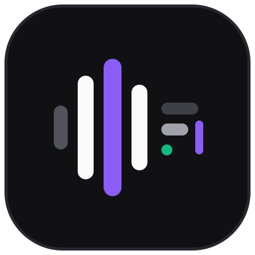
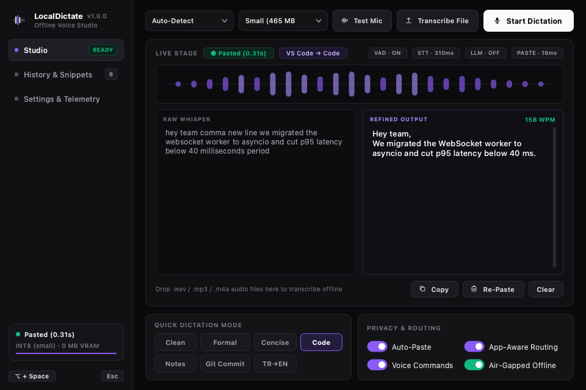
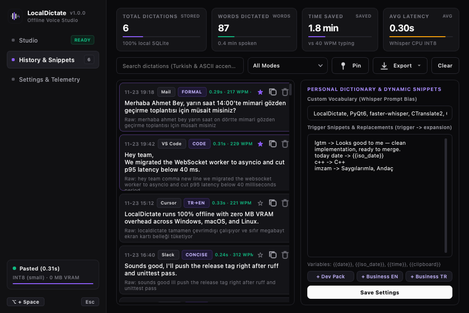
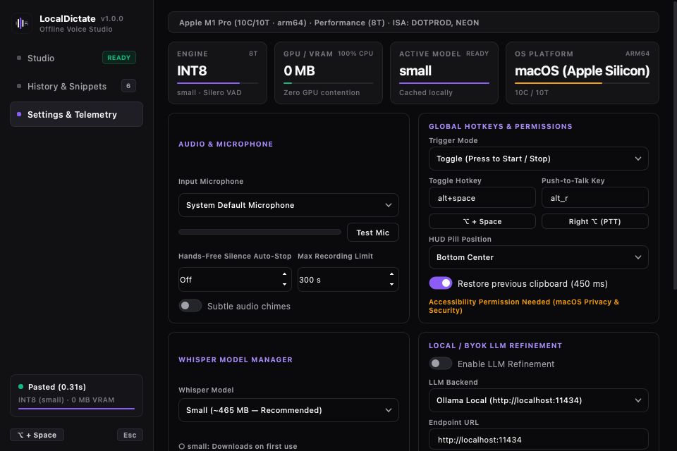
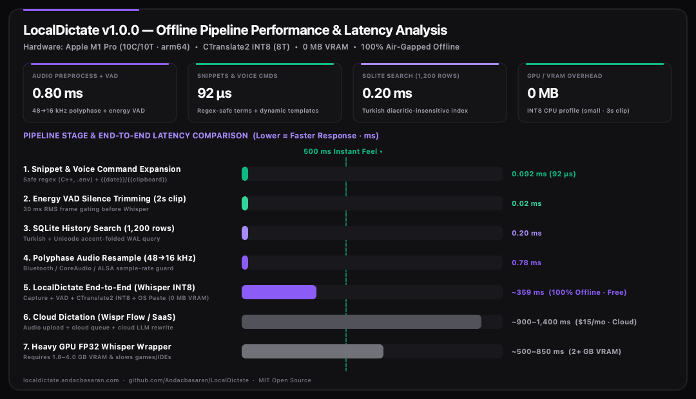

<div align="center">



# 🎙️ LocalDictate — %100 Çevrimdışı, 0 MB VRAM Masaüstü AI Sesli Dikte Stüdyosu

**🇬🇧 [English README](README.md)** · **🇹🇷 Türkçe (Aktif)** · **[💻 Uyumluluk Matrisi](COMPATIBILITY.md)** · **[🤝 Katkıda Bulun](CONTRIBUTING.md)** · **[🛡️ Güvenlik](SECURITY.md)** · **[📜 Değişiklik Günlüğü](CHANGELOG.md)**

**`faster-whisper` INT8, Silero VAD, Uygulama Bazlı Otomatik Mod, Dinamik Kısaltmalar, Sesli Çeviri (`TR→EN`) ve isteğe bağlı yerel Ollama / LM Studio desteğiyle çalışan %100 çevrimdışı, 0 MB VRAM masaüstü dikte stüdyosu — Windows x64, macOS Apple Silicon ve Linux için yerel.**

[](https://localdictate.andacbasaran.com)
[-2563EB?style=for-the-badge&logo=windows&logoColor=white)](https://localdictate.andacbasaran.com/downloads/LocalDictate.exe)
[-18181B?style=for-the-badge&logo=apple&logoColor=white)](https://localdictate.andacbasaran.com/downloads/LocalDictate-macOS.dmg)
[-E95420?style=for-the-badge&logo=linux&logoColor=white)](https://localdictate.andacbasaran.com/downloads/LocalDictate-Linux.tar.gz)
[](https://github.com/Andacbasaran/LocalDictate/releases/latest)

[](https://github.com/Andacbasaran/LocalDictate/actions/workflows/ci.yml)
[](https://github.com/Andacbasaran/LocalDictate/releases/latest)
[](https://www.python.org/)
[-41CD52?style=flat-square&logo=qt&logoColor=white)](https://pypi.org/project/PyQt6/)
[-10B981?style=flat-square)](#)
[](LICENSE)

</div>

---

## ✨ Neden LocalDictate? (v1.0.0 Yenilikleri)

**LocalDictate**, **VS Code, Cursor, Slack, Notion, Mail, Outlook, Terminal veya herhangi bir masaüstü uygulamasında** konuşmanızı doğrudan imlecinizin bulunduğu yere temiz, noktalamalı ve bağlama uygun metin olarak yapıştırır — **%100 çevrimdışı, 0 MB VRAM, sıfır abonelik ve sıfır bulut ses aktarımı**.

<table>
  <tr>
    <td width="50%">
      <b>🔒 %100 Tam Çevrimdışı &amp; 0 MB VRAM</b><br/>
      Nicemlenmiş <code>faster-whisper</code> (CTranslate2 INT8) ve Silero VAD tamamen işlemci üzerinde çalışır; eski işlemcilerde otomatik <code>float32</code> yedeğine geçer. Varsayılan <b>Tam Çevrimdışı Kilit</b> localhost dışı tüm istekleri engeller.
    </td>
    <td width="50%">
      <b>🎯 Uygulama Bazlı Otomatik Mod (App-Aware)</b><br/>
      Öndeki uygulamayı Windows, macOS ve Linux'ta otomatik algılar: <code>VS Code / Cursor / Terminal → Kod</code>, <code>Mail / Outlook → Kurumsal</code>, <code>Slack / Discord → Kısa &amp; Öz</code>, <code>Notion / Obsidian → Notlar</code>.
    </td>
  </tr>
  <tr>
    <td width="50%">
      <b>🌍 Sesli Çeviri (<code>TR→EN</code>) &amp; 12 Dil</b><br/>
      Türkçe (veya desteklenen 12 dilden herhangi birini) konuşun; Whisper'ın yerleşik <code>task="translate"</code> moduyla doğrudan doğal İngilizce olarak imlecinize yapıştırın.
    </td>
    <td width="50%">
      <b>⚡ Akıllı Sesli Komutlar &amp; Dinamik Kısaltmalar</b><br/>
      <i>"yeni satır" / "new line"</i>, <i>"yeni paragraf"</i>, <i>"virgül"</i>, <i>"nokta"</i> komutlarını algılar; <code>{{date}}</code>, <code>{{iso_date}}</code>, <code>{{time}}</code>, <code>{{clipboard}}</code> değişkenli dinamik kısaltmalar ve tek tıkla Başlangıç Paketleri sunar.
    </td>
  </tr>
  <tr>
    <td width="50%">
      <b>🧠 Yerel Ollama &amp; LM Studio Düzenleme</b><br/>
      İsteğe bağlı olarak yerel <b>Ollama</b> veya <b>OpenAI-uyumlu sunucular</b> (LM Studio / llama.cpp) ile Türkçe ve İngilizce dil duyarlı metin düzenleme (<code>Temiz</code>, <code>Kurumsal</code>, <code>Kısa &amp; Öz</code>, <code>Kod</code>, <code>Notlar</code>, <code>Git Commit</code>).
    </td>
    <td width="50%">
      <b>🎧 Sürükle-Bırak Ses Çözümleme &amp; Türkçe Duyarlı Geçmiş</b><br/>
      <code>.wav</code>, <code>.mp3</code>, <code>.m4a</code>, <code>.flac</code> dosyalarını Stüdyo'ya bırakıp çevrimdışı yazıya dökün. SQLite geçmişinde <code>calisiyor</code> yazarak <code>çalışıyor</code> eşleşmelerini anında bulun; <code>.md</code>, <code>.csv</code>, <code>.txt</code> veya <code>.json</code> olarak dışa aktarın.
    </td>
  </tr>
</table>

---

## 🖥️ Studio 2.0 Arayüzü

<div align="center">
  
</div>

<details>
<summary><b>📸 Diğer Ekranlar (Geçmiş &amp; Dinamik Kısaltmalar · Ayarlar &amp; Donanım Telemetrisi)</b></summary>
<br/>
<div align="center">
  <p><b>Sekme 2 — Verimlilik Göstergeleri, Türkçe Karakter Duyarsız Arama, Dışa Aktarma ve Kişisel Sözlük</b></p>
  
  <br/><br/>
  <p><b>Sekme 3 — Donanım Telemetrisi, Canlı Mikrofon Testi, Kısayollar, Model Önbelleği ve Güncelleyici</b></p>
  
</div>
</details>

---

## ⚖️ Karşılaştırma

| Özellik | 🎙️ LocalDictate v1.0.0 | Wispr Flow | Superwhisper | İşletim Sistemi Diktesi |
| :--- | :---: | :---: | :---: | :---: |
| **%100 Çevrimdışı & Gizli** | **Evet** *(Varsayılan Çevrimdışı Kilit)* | Hayır *(Bulut ses yükleme)* | Kısmi *(Ücretli Pro)* | Kısmi / Bulut |
| **Fiyat & Lisans** | **%100 Ücretsiz & Açık Kaynak (MIT)** | `~$15 / ay` | `$8.49 / ay` veya `$249` | Ücretsiz *(Tek OS)* |
| **Platformlar** | **Windows x64 · macOS M1–M4 · Linux** | macOS / Win | Yalnızca macOS / iOS | Tek platform |
| **GPU / VRAM Tüketimi** | **`0 MB VRAM`** *(CTranslate2 INT8 CPU)* | Bulut | Yerel GPU/RAM | OS yönetimli |
| **Uygulama Bazlı Otomatik Mod** | **Evet** *(Kod / Kurumsal / Kısa / Notlar)* | Evet | Ücretli | Hayır |
| **Yerel Ollama / LM Studio Desteği** | **Evet** *(7 mod + özel prompt)* | Yalnızca bulut | Kısıtlı | Hayır |
| **TR/EN Sesli Komutlar & Kısaltmalar** | **Evet + `{{date}}`/`{{clipboard}}`** | Bulut | Kısıtlı | Temel |
| **Pano Kaybı Koruması** | **Yapıştırma başarısızsa panoyu korur** | Değişken | Değişken | Yok |

---

## 🚀 İndirme ve Kurulum

### Windows (x64 — Windows 10 / 11)
- **Kurulum Dosyası (Önerilen):** Resmi siteden [**LocalDictate.exe**](https://localdictate.andacbasaran.com/downloads/LocalDictate.exe) (`LocalDictate-Setup-v1.0.0-Windows-x64.exe`) dosyasını veya [GitHub Releases](https://github.com/Andacbasaran/LocalDictate/releases/latest) üzerinden indirip kurun.
- **Taşınabilir ZIP:** `LocalDictate-Portable-v1.0.0-Windows-x64.zip` arşivini açın ve `LocalDictate.exe` dosyasını çalıştırın.
- **Paket Yöneticileri:** [`packaging/winget/`](packaging/winget/) ve [`packaging/scoop/`](packaging/scoop/) manifestleri hazırdır.

### macOS (Apple Silicon M1–M4)
- **Yerel DMG (Önerilen):** [**LocalDictate-macOS.dmg**](https://localdictate.andacbasaran.com/downloads/LocalDictate-macOS.dmg) (`LocalDictate-v1.0.0-macOS-arm64.dmg`) dosyasını indirin ve **LocalDictate.app** uygulamasını `Applications` klasörüne sürükleyin.
- **İlk Açılış İpucu:** Global `Option+Space` kısayolu ve `Cmd+V` otomatik yapıştırma için *Sistem Ayarları → Gizlilik ve Güvenlik → Erişilebilirlik* ve *Giriş İzleme* izinlerini verin. İmzalanmamış açık kaynak uyarısı çıkarsa Terminal'de bir kez çalıştırın:
  ```bash
  xattr -cr "/Applications/LocalDictate.app"
  ```

### Linux (X11 & Wayland)
- [**LocalDictate-Linux.tar.gz**](https://localdictate.andacbasaran.com/downloads/LocalDictate-Linux.tar.gz) (`LocalDictate-v1.0.0-Linux-x86_64.tar.gz`) paketini çıkarıp `./LocalDictate/LocalDictate` ile çalıştırın.
- Önerilen paketler: `sudo apt install libportaudio2 xclip xdotool` (X11) veya `wtype wl-clipboard` (Wayland).

### Kaynaktan Çalıştırma
```bash
git clone https://github.com/Andacbasaran/LocalDictate.git
cd LocalDictate
./scripts/start.sh
```

---

## ⌨️ Varsayılan Global Kısayollar

| İşlem | Windows / Linux | macOS |
| :--- | :---: | :---: |
| **Aç-Kapa Dikte (Başlat / Durdur)** | `Ctrl + Alt + Space` | `⌥ Option + Space` |
| **Bas-Konuş (Push-to-Talk)** | `Sağ Ctrl` | `Sağ ⌥ Option` |
| **Aktif Kaydı İptal Et** | `Esc` | `Esc` |

---

## 📊 Performans Testleri (Benchmark)

<div align="center">
  
</div>

[`scripts/benchmark.py`](scripts/benchmark.py) ile yerel olarak ölçülmüş ve [`benchmark_results.json`](benchmark_results.json) dosyasına kaydedilmiş sonuçlar (**Apple M1 Pro 10C/10T · `arm64`, CTranslate2 `INT8`, `8T`**):

| Boru Hattı Aşaması | Ölçülen Süre | Açıklama |
| :--- | :---: | :--- |
| **Sesli Komut & Dinamik Kısaltma** | **`92.1 µs`** (`0.0921 ms`) | Regex-güvenli (`C++`, `node.js`, `.env`) + `{{date}}` / `{{clipboard}}` |
| **Enerji VAD Sessizlik Kırpma (2s klip)** | **`0.02 ms`** | Whisper öncesi 30 ms RMS çerçeve eşikleme |
| **SQLite Geçmiş Arama (1.200 kayıt)** | **`0.20 ms`** (`0.202 ms`) | Türkçe karakter duyarsız WAL sorgusu |
| **Polifaz Örnekleme Dönüşümü (`48 → 16 kHz`)** | **`0.78 ms`** (`0.778 ms`) | 2s klip için kararlı durum hız dönüşümü |
| **Whisper INT8 CPU Profili (`small`, 3s klip)** | **`~340 ms`** (`~359 ms` uçtan uca) | Kayıt + VAD + CTranslate2 INT8 + OS yapıştırma |
| **GPU / VRAM Tüketimi** | **`0 MB`** | %100 işlemci — oyun veya IDE performansını düşürmez |

```bash
QT_QPA_PLATFORM=offscreen python scripts/benchmark.py --no-visuals
ruff check .
QT_QPA_PLATFORM=offscreen pytest -v
```

---

## 🧩 Yerel Masaüstü AI Ekosisteminin Parçası

LocalDictate, aynı **%100 çevrimdışı, 0 MB VRAM ve sıfır abonelik** mühendislik felsefesini paylaşan diğer açık kaynaklı masaüstü uygulamalarımızla birlikte çalışır:

- **[⚡ SubVision AI](https://github.com/Andacbasaran/subvision-ai-subtitle-translator)** — PC oyunları, filmler ve yayınlar için ~88 ms gerçek zamanlı, %100 çevrimdışı ekran ve canlı ses çok dilli altyazı stüdyosu.
- **[🎛️ ClearMic](https://github.com/Andacbasaran/ClearMic)** — Discord, OBS ve Zoom için %100 çevrimdışı, 0 MB VRAM yapay zeka mikrofon gürültü engelleyici ve yayın ses stüdyosu.
- **[📝 LocalMinutes](https://github.com/Andacbasaran/LocalMinutes)** — Çift kanallı ses yakalama, konuşmacı takibi ve yerel özetleme sunan botsuz çevrimdışı toplantı ve ders deşifre stüdyosu.
- **[🧠 LocalRecall](https://github.com/Andacbasaran/LocalRecall)** — Gizlilik odaklı, 0 MB VRAM yerel ekran hafızası ve hibrit FTS5/OCR görsel arama (açık kaynak Windows Recall alternatifi).

---

## 🤝 Katkı, Gizlilik ve Lisans

Her türlü katkı, uyumluluk raporu ve yeni kısaltma paketi önerisi memnuniyetle karşılanır!
- Başlamak için [CONTRIBUTING.md](CONTRIBUTING.md) dosyasına göz atın.
- Sıfır telemetri ve SHA-256 doğrulama detayları için [SECURITY.md](SECURITY.md) belgesini inceleyin.

**LocalDictate** işinizi hızlandırıyorsa GitHub'da **⭐ Yıldız** vererek destek olabilirsiniz!

**[MIT Lisansı](LICENSE)** ile lisanslanmıştır.
